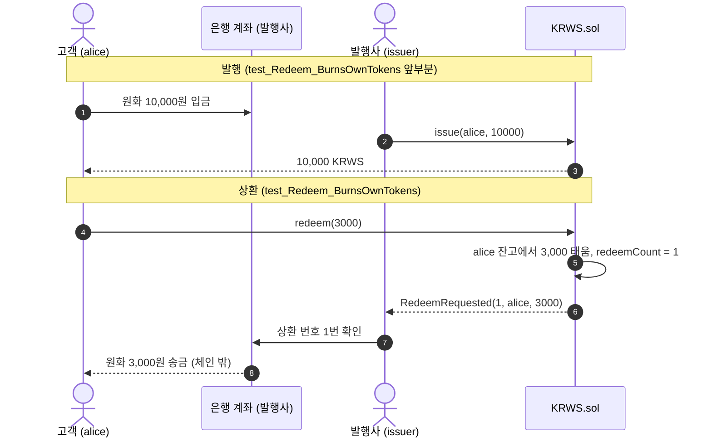
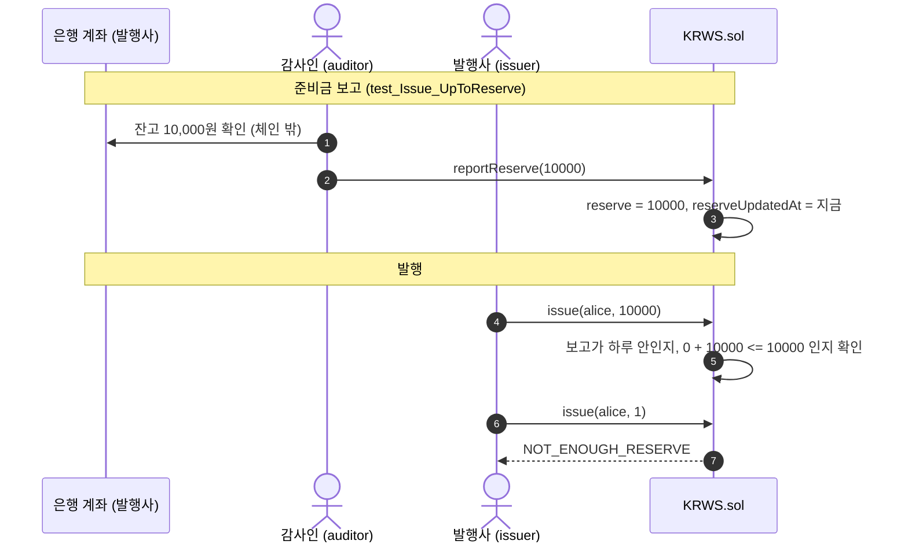

# KRW Stablecoin Lab (KRWS)


원화 스테이블코인을 발행사 입장에서 처음부터 만들어 보는 실습 레포입니다. **1 KRWS = 1원**으로 정하고, 발행과 상환부터 시작해서 준비금 확인, KYC, 동결, 발행 한도처럼 실제 발행사가 갖춰야 할 기능을 한 단계씩 붙여 나갈 계획입니다. 나중에는 직접 만들고 있는 체인 [KRES](https://github.com/Andrewpark-hub/kres) 위로 옮기는 것까지 해 볼 생각입니다.

> ⚠️ 테스트넷 학습용입니다. 실제 원화와 교환되지 않고, 메인넷에 배포하지 않습니다. 이미 있는 다른 원화 토큰(KRWT 등)과는 관련이 없습니다.

## 왜 만드나

국내에서는 원화 스테이블코인을 허용하는 디지털자산기본법이 논의되고 있다. 지금까지 나온 안들은 금융위원회 인가, 준비자산 100% 보유, 최소 자기자본을 공통으로 담고 있고, 자기자본 기준은 안마다 5억, 10억, 50억 원으로 다르다. 2026년 1월 보도로는 처음엔 은행 중심 컨소시엄부터 발행을 허용하는 방향이다. 2026년 10월 기준으로도 법은 아직 만들어지지 않았다.

법이 정해지면 발행사는 이 조건들을 코드로 지켜야 한다. 그래서 단계마다 "이 조건을 컨트랙트로 어떻게 지키나, 어디까지는 코드로 못 지키나"를 직접 확인해 보려고 한다.

- 민병덕 의원 디지털자산기본법 발의 (자본금 5억 원): [파이낸셜뉴스 2025-06-16](https://www.fnnews.com/news/202506161308049313)
- 자기자본 10억 원 안: [딜사이트](https://dealsite.co.kr/articles/143153)
- 은행 중심 단계적 허용, 자기자본 50억 원 전망: [파이낸셜뉴스 2026-01-07](https://www.fnnews.com/news/202601071047230515)
- 발행 자격이 아직 쟁점: [CEO스코어데일리 2026-10-21](https://ceoscoredaily.com/page/view/2026102116085383431)

## 프로젝트 핵심 요소 (1단계)

1. **발행은 발행사만**
   - 고객이 은행에 원화를 넣으면 발행사가 `issue(to, amount)` 로 같은 금액을 찍어 준다.
   - 발행사 말고 다른 주소가 부르면 `OwnableUnauthorizedAccount` 로 막힌다 (`test_Fix_OnlyIssuerCanIssue`).
   - 0원 발행은 `ZERO_AMOUNT` 로 막는다 (`test_Issue_ZeroAmountReverts`).

2. **상환은 보유자가 직접 태워서 신청**
   - 처음엔 발행사가 `burn(from, amount)` 로 태워 주면 된다고 생각했다 (`test/naive/NaiveKRWS.sol`). 그런데 이러면 발행사가 고객 동의 없이 아무 지갑의 잔고나 지울 수 있었다 (`test_Exploit_IssuerErasesBalance`).
   - 고친 버전은 `redeem(amount)` 하나만 두고, 부른 사람 자기 잔고만 태운다. 발행사가 불러도 발행사 잔고에서 빠지려다 실패한다 (`test_Fix_IssuerCannotBurnOthers`).
   - 태울 때 상환 번호(`redeemCount`)를 붙여 `RedeemRequested` 이벤트를 남긴다. 발행사는 이 번호로 은행 송금 내역과 맞춰 본다 (`test_Redeem_BurnsOwnTokens`).

3. **소수점 없음**
   - 원화는 1원 밑으로 안 쪼개서 `decimals()` 를 0으로 뒀다. USDC는 6이다.
   - 1 KRWS를 보내면 1원이 그대로 간다 (`test_Transfer_WholeWonOnly`).

## 프로젝트 핵심 요소 (2단계)

1단계에서는 은행에 원화가 한 푼도 없어도 발행사가 1조 원어치를 찍을 수 있었다. 법안들이 공통으로 요구하는 "준비자산 100% 보유"를 코드로 지키는 단계다.

1. **준비금보다 많이 못 찍음**
   - `issue` 할 때 `totalSupply() + amount <= reserve` 를 확인한다. 이번에 찍는 양만 보지 않고 이미 나간 양까지 더한다 (`test_Issue_CountsAlreadyIssued`).
   - 딱 준비금만큼은 되고 1원만 넘어도 `NOT_ENOUGH_RESERVE` 로 막힌다 (`test_Issue_UpToReserve`).
   - 은행 잔고가 줄었다고 보고가 올라오면 새 발행만 막히고, 이미 가진 토큰은 그대로 주고받을 수 있다 (`test_Reserve_DropBelowSupply`).

2. **준비금은 발행사가 아니라 감사인이 올림**
   - 처음엔 발행사가 은행 잔고를 직접 올리게 만들었다 (`test/naive/NaiveReserveKRWS.sol`). 그런데 발행사가 "1조 원 있음" 이라고 올리고 바로 1조 원을 찍으면 검사가 아무 의미가 없었다 (`test_Exploit_IssuerReportsFakeReserve`).
   - 고친 버전은 생성자에서 감사인 주소(`auditor`)를 따로 받고, `reportReserve` 는 감사인만 부를 수 있다 (`test_Fix_OnlyAuditorCanReport`).
   - 감사인과 발행사를 같은 주소로 만들면 생성자에서 `AUDITOR_IS_ISSUER` 로 막는다 (`test_Fix_AuditorCannotBeIssuer`).

3. **보고는 하루만 유효**
   - 감사인이 한 달 전에 올린 숫자를 믿고 계속 찍으면 안 된다. 보고하고 하루(`REPORT_VALID_FOR = 1 days`)가 지나면 `RESERVE_REPORT_OLD` 로 발행이 멈춘다 (`test_Fix_OldReportBlocksIssue`).
   - 정확히 하루가 된 시점까지는 된다 (`test_Issue_ReportValidForExactlyOneDay`).
   - 보고가 한 번도 없으면 올린 시각이 0이라 이 검사에서 먼저 막힌다 (`test_Fix_IssueWithoutReserveReverts`).

### 그리고 아직 못 고친 것

- 감사인이 은행 잔고를 거짓으로 올리면 코드로는 알 수 없다 (`test_Limit_AuditorCanLie`). 발행사 혼자 거짓말하던 걸 두 곳이 짜야 가능하게 바꾼 것까지다.
- 상환하면 은행에서 원화가 빠져나가는데, 감사인이 새로 올리기 전까지 `reserve` 는 예전 숫자 그대로다. 그 사이 발행사가 빠진 만큼 다시 찍을 수 있다 (`test_Limit_ReserveNotUpdatedAfterRedeem`). 보고를 하루만 믿게 해서 그 기간을 하루로 줄인 정도다.
- `RedeemRequested` 는 신청 기록일 뿐이다. 발행사가 실제로 원화를 보냈는지는 체인에서 알 수 없다.
- 발행사 키 하나가 털리면 준비금 안에서는 마음대로 찍을 수 있다. 6단계에서 멀티시그로 바꾼다.

## 시스템 아키텍처 & 라이프사이클 흐름



2단계에서 발행 앞에 감사인 보고가 하나 더 붙었다.



## 기술 스택

| 구분 | 사용 기술 |
| --- | --- |
| 언어 | Solidity 0.8.31 (EVM osaka) |
| 라이브러리 | OpenZeppelin Contracts 5.1.0 (ERC20, Ownable) |
| 테스트 | Foundry (forge 1.8.1), forge-std 1.17.0 |

## 트러블슈팅 및 환경 최적화

> **문제 상황**
> 검사를 하나씩 지워 보면서 테스트가 잡는지 확인했는데, `redeem` 의 `require(amount > 0, "ZERO_AMOUNT")` 를 지워도 테스트 8개가 전부 통과했다.
>
> **원인 분석**
> `issue` 의 0원 검사 테스트만 만들고 `redeem` 쪽은 안 만들었다. OpenZeppelin `_burn` 은 0을 넣어도 되돌리지 않아서, 검사를 지우면 0원짜리 상환 신청이 그냥 쌓인다.
>
> **해결 방안**
> `test_Redeem_ZeroAmountReverts` 를 추가했다. 지금은 `onlyOwner`, `ZERO_AMOUNT` 두 개, `redeemCount++`, `decimals` 다섯 군데를 각각 지우면 실패하는 테스트가 하나씩 있다.

> **문제 상황 (2단계)**
> 보고가 한 번도 없을 때 발행하면 `RESERVE_REPORT_OLD` 로 막힐 거라고 생각했는데, 테스트에서는 `NOT_ENOUGH_RESERVE` 가 나왔다.
>
> **원인 분석**
> Foundry 테스트는 `block.timestamp` 가 1에서 시작한다. 보고가 없으면 `reserveUpdatedAt` 이 0이라 `1 <= 0 + 1 days` 가 참이 되어 시간 검사를 그냥 통과했다. 실제 체인에서는 지금 시각이 17억 초쯤이라 시간 검사에서 먼저 막힌다. 테스트 환경과 실제 체인에서 다른 에러가 나고 있었다.
>
> **해결 방안**
> `02_Reserve.t.sol` 의 `setUp` 에서 `vm.warp(1_763_000_000)` 으로 2025년 11월쯤 시각으로 옮겼다. 이제 테스트에서도 `RESERVE_REPORT_OLD` 가 나온다. 2단계 검사 여덟 군데(`ONLY_AUDITOR`, `NOT_ENOUGH_RESERVE`, `totalSupply()` 더하기, 시간 검사, `<=` 를 `<` 로, 보고 시각 저장, 준비금 저장, `AUDITOR_IS_ISSUER`)도 하나씩 지워서 매번 실패하는 테스트가 있는지 확인했다.

## 실행 가이드 (Quick Start)

사전 조건: [Foundry](https://book.getfoundry.sh/getting-started/installation)

```bash
git clone --recurse-submodules https://github.com/Andrewpark-hub/krw-stablecoin-lab.git
cd krw-stablecoin-lab
forge test -vv
```

## 로드맵

| 단계 | 내용 | 상태 |
| --- | --- | --- |
| 1 | 발행사만 발행, 보유자가 직접 상환 | ✅ 2026-11-07 |
| 2 | 준비금 확인: 감사인이 올린 은행 잔고보다 많이 못 찍게 | ✅ 2026-11-14 |
| 3 | KYC: 확인된 주소끼리만 주고받기 | |
| 4 | 동결: 범죄 연루 주소 동결 ([stablecoin-freeze-zk-lab](https://github.com/Andrewpark-hub/stablecoin-freeze-zk-lab) 연결) | |
| 5 | 하루 발행 한도와 긴급 정지 | |
| 6 | 발행 승인을 여러 명 서명으로 (멀티시그) | |
| 7 | 준비금과 발행량을 보여주는 웹 화면 | |
| 8 | Spring + web3j 백엔드 연결 | |
| 9 | 테스트넷 Uniswap에 KRWS/USDC 풀 만들어 환전 흉내 | |

법안이 바뀌거나 새 기사가 나오면 해당 단계에 반영하고 아래 기록에 남긴다.

## 업데이트 기록

- **2026-11-14** 2단계. 감사인 보고(`reportReserve`)와 발행 조건 두 개, 처음 만든 버전 `NaiveReserveKRWS.sol`, 테스트 12개 추가. 1단계의 `test_Limit_IssueWithoutReserve` 는 고쳐서 `test_Fix_IssueWithoutReserveReverts` 로 옮김. 전체 테스트 20개.
- **2026-11-07** 1단계. `KRWS.sol`, 처음 만든 버전 `NaiveKRWS.sol`, 테스트 9개.

## 파일 구조

```
krw-stablecoin-lab/
├── src/
│   └── KRWS.sol                 # 원화 스테이블코인 (2단계까지)
├── test/
│   ├── 01_IssueRedeem.t.sol     # 발행, 상환 테스트 8개
│   ├── 02_Reserve.t.sol         # 준비금 테스트 12개
│   └── naive/
│       ├── NaiveKRWS.sol        # 1단계 처음 만든 버전 (발행사가 남의 잔고를 지움)
│       └── NaiveReserveKRWS.sol # 2단계 처음 만든 버전 (발행사가 준비금을 직접 올림)
└── foundry.toml
```

*학습용으로 만든 레포라 실제 서비스에 쓰면 안 됩니다. 법안 내용은 위 기사 기준이고 1차 자료(법안 원문)는 아직 직접 확인하지 않았습니다.*
